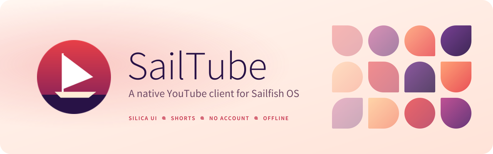
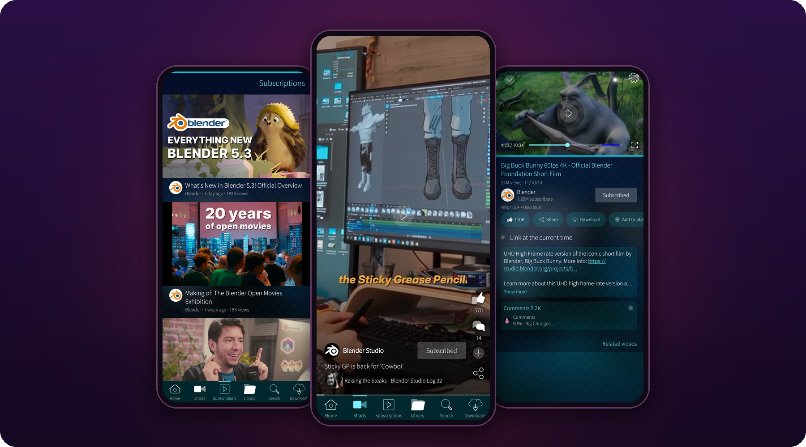
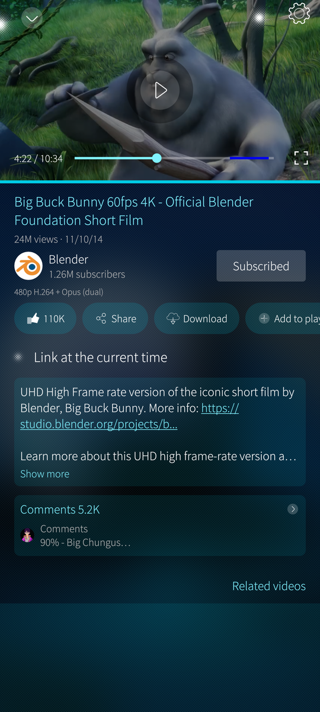
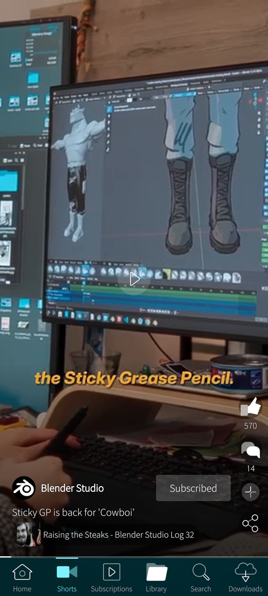
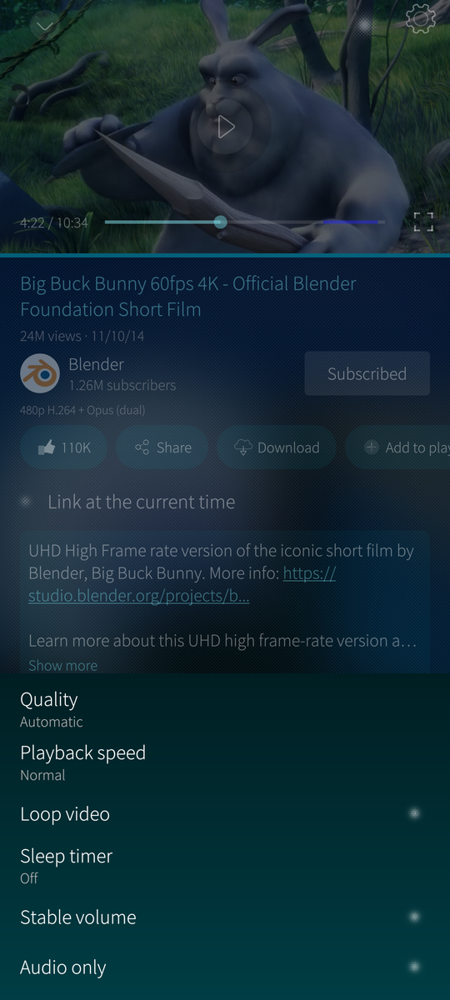
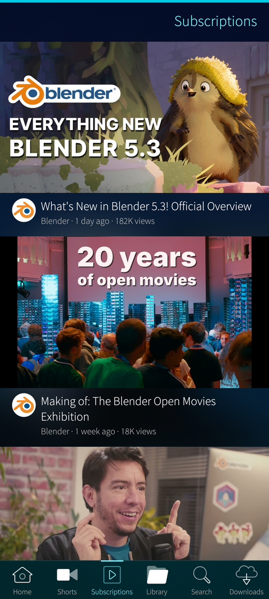
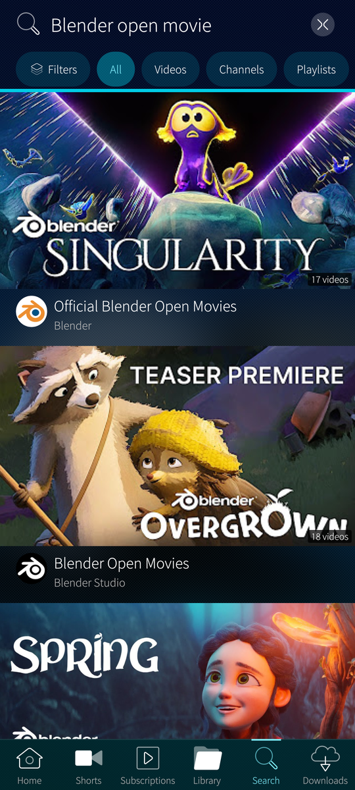
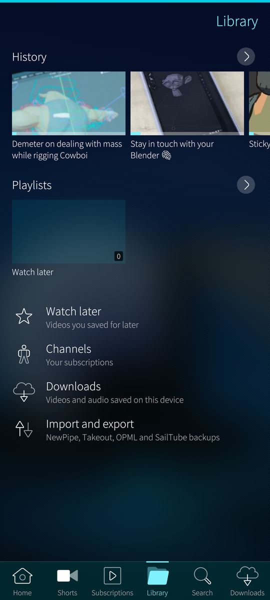
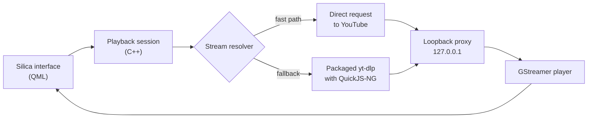

<div align="center">
  <picture>
    <source media="(prefers-color-scheme: dark)" srcset="assets/banner-dark.svg">
    
  </picture>

  <h3>Watch YouTube on Sailfish OS the way the phone was meant to be used.</h3>
  <p>A native Silica app with its own player, Shorts, downloads and a local library.<br>No account, no ads, no tracking.</p>

  <a href="https://github.com/NordiLabs/SailTube/releases/latest"><picture><source media="(prefers-color-scheme: dark)" srcset="assets/badges/download-dark.svg"></picture></a>
  <a href="#requirements"><picture><source media="(prefers-color-scheme: dark)" srcset="assets/badges/sailfish-dark.svg"></picture></a>
  <a href="#requirements"><picture><source media="(prefers-color-scheme: dark)" srcset="assets/badges/arch-dark.svg"></picture></a>
  <br>
  <a href="#privacy"><picture><source media="(prefers-color-scheme: dark)" srcset="assets/badges/privacy-dark.svg"></picture></a>
  <a href="#translations"><picture><source media="(prefers-color-scheme: dark)" srcset="assets/badges/languages-dark.svg"></picture></a>
  <a href="LICENSE"><picture><source media="(prefers-color-scheme: dark)" srcset="assets/badges/licence-dark.svg"></picture></a>
  <a href="https://ko-fi.com/nordsail"><picture><source media="(prefers-color-scheme: dark)" srcset="assets/badges/kofi-dark.svg"></picture></a>

  <br><br>

  

  <br><br>

  <sub>
    <a href="#why-sailtube">Why SailTube</a> ·
    <a href="#screenshots">Screenshots</a> ·
    <a href="#download">Download</a> ·
    <a href="#features">Features</a> ·
    <a href="#privacy">Privacy</a> ·
    <a href="#faq">FAQ</a> ·
    <a href="#roadmap">Roadmap</a> ·
    <a href="#support-sailtube">Support</a> ·
    <a href="#building">Building</a>
  </sub>
</div>

<br>

> [!WARNING]
> **Public beta: this build stops working on 30 December 2026** (end of day, phone time). From 16 December the app shows a
> reminder. After the end date it opens only a page where you can still export a backup. Your subscriptions, playlists,
> history and downloads are never deleted or changed, and the next beta installs over this one. Details in
> [docs/BETA.md](docs/BETA.md).

## Why SailTube?

Most ways to watch YouTube on a Sailfish phone are a website in a window: small buttons, no background playback, nothing
that feels like the rest of the phone. SailTube is a **native Silica app**. It follows the system's look, gestures and
ambience, plays video through its own GStreamer player and keeps your library on the phone. Even its artwork follows
Jolla's app icon story: the same base shapes, diagonal gradients and flat symbols as the icons on your home screen.

<table>
<tr>
<td width="33%" valign="top">


### Feels like Sailfish
Pulley menus, pages you swipe back from, the ambience colours, a live cover, lock-screen and headset controls.

</td>
<td width="33%" valign="top">


### Starts fast
Videos usually start in a second or two on a mid-range phone. The next Short is prepared while you watch the current one,
and a stalled video recovers by itself.

</td>
<td width="33%" valign="top">


### Yours, not theirs
No account needed, no ads, no telemetry. Subscriptions, playlists, history and downloads live on the phone and can be
exported whenever you want.

</td>
</tr>
</table>

SailTube is an independent project. It is not affiliated with or endorsed by YouTube or Google.

## Screenshots

<div align="center">
  <table>
    <tr>
      <td align="center"><br><b>Watch</b><br><sub>Action chips, description, comments</sub></td>
      <td align="center"><br><b>Shorts</b><br><sub>Swipe up for the next one</sub></td>
      <td align="center"><br><b>Player settings</b><br><sub>Quality, speed, captions, audio</sub></td>
    </tr>
    <tr>
      <td align="center"><br><b>Subscriptions</b><br><sub>Built locally, no account</sub></td>
      <td align="center"><br><b>Search</b><br><sub>Suggestions and filter chips</sub></td>
      <td align="center"><br><b>Library</b><br><sub>Playlists, Watch later, downloads</sub></td>
    </tr>
  </table>
</div>

## Download

<div align="center">
  <a href="https://github.com/NordiLabs/SailTube/releases/latest"><picture><source media="(prefers-color-scheme: dark)" srcset="assets/badges/download-dark.svg"></picture></a>
</div>

<br>

SailTube is installed directly from this page; it is not in the Jolla Store (see the [FAQ](#faq)).

1. Download `harbour-sailtube-<version>.aarch64.rpm` from the [latest release](https://github.com/NordiLabs/SailTube/releases/latest).
2. On the phone, open *Settings → System → Untrusted software* and allow installing.
3. Open the downloaded file and tap **Install**. From a terminal on the phone:

   ```bash
   pkcon install-local harbour-sailtube-<version>.aarch64.rpm
   ```

To update, install the newer RPM over the old one; your data is kept. SailTube does not update itself, so watch the
releases (*Watch → Custom → Releases* at the top of this page) to hear about new builds.

> [!IMPORTANT]
> If you installed an earlier SailTube build from another page, uninstall it first. The application identifiers changed,
> so this build starts with empty data. Export a backup from the old build if you want to keep your library.

### Requirements

| | |
|---|---|
| **System** | Sailfish OS 5.1 or later |
| **Processor** | aarch64 (64-bit ARM) |
| **Tested on** | Sailfish OS 5.2, POCO X3 Pro |
| **Dependencies** | `pyotherside`, `Amber.Mpris` and `Nemo.KeepAlive`, installed from the Sailfish repositories |

### Verifying the download

Each release lists the SHA-256 of its RPM. Check it before installing:

```bash
sha256sum harbour-sailtube-0.1.0-0.beta3.aarch64.rpm
# f59fc578b12f1f5bde385d6023a6269e8d97a44690ea24bad25964bdd70fa6f2
```

If the two do not match, do not install the file; download it again from the release page.

## Features

<table>
<tr>
<td width="50%" valign="top">


#### Playback
- Adaptive streams up to 1080p where the phone can decode them, live streams, audio-only and background playback.
- A settings sheet for quality, speed, captions, audio track, loop, sleep timer and stable volume.
- A seek bar with chapters and SponsorBlock segments, double-tap to seek, swipe to enter or leave fullscreen.
- Captions drawn over the video, also for streamed videos.
- Mini-player, live video on the app cover, lock-screen and headset controls (MPRIS).

</td>
<td width="50%" valign="top">


#### Shorts
- The first Short plays as soon as you open the tab; swipe up for the next one, down for the previous one.
- The next Short is prepared while you watch, so the swipe does not wait.
- Like and comment counts, save, share, the channel with Subscribe, and the related video, over the picture.

</td>
</tr>
<tr>
<td valign="top">


#### Browse
- Home, Shorts, Subscriptions, Library, Search and Downloads in a bottom bar.
- Videos as cards with channel avatars; a watch page with action chips, a collapsible description and a comments preview.
- Opens `youtube.com`, `youtu.be` and `m.youtube.com` links when SailTube is your link handler.

</td>
<td valign="top">


#### Library and downloads
- Local playlists, Watch later and history with resume points.
- Downloads of video or audio, with captions, played offline inside SailTube.
- Import from NewPipe and PipePipe backups, Google Takeout and OPML; export and import of SailTube's own backup.

</td>
</tr>
<tr>
<td valign="top">


#### Extras
- [SponsorBlock](https://sponsor.ajay.app/) segments and [Return YouTube Dislike](https://returnyoutubedislike.com/) counts, both optional.
- Signing in is optional, by importing a browser session.

</td>
<td valign="top">


#### Private by design
- No servers of its own, no analytics, no crash reporting.
- Streams are resolved on the phone; every host it talks to is listed [below](#privacy).

</td>
</tr>
</table>

## Privacy

SailTube has no servers of its own, no analytics and no crash reporting. It only talks to the hosts it needs to show and
play what you asked for:

| Host | Why |
|---|---|
| `www.youtube.com`, `youtube.com` | Pages, search, feeds and stream information |
| `*.googlevideo.com` | The video and audio streams themselves |
| `i.ytimg.com`, `yt3.ggpht.com`, `*.googleusercontent.com` | Thumbnails and channel pictures |
| `suggestqueries.google.com` | Search suggestions while you type |
| `sponsor.ajay.app` | SponsorBlock segments; only the first 4 characters of a hash of the video id are sent, never the id |
| `returnyoutubedislikeapi.com` | Dislike counts; off unless you turn it on |
| `github.com` and its release asset hosts | Only when you check for an update of the stream extractor; no account or device id is sent |

Streams are resolved on the phone by the packaged extractor and played through a small proxy that listens only on the
phone itself (`127.0.0.1`). The full list, with what is sent to each host, is in
[docs/PRIVACY_NETWORK.md](docs/PRIVACY_NETWORK.md).

## How it works



The design is in [docs/ARCHITECTURE.md](docs/ARCHITECTURE.md) and the player in
[docs/PLAYBACK.md](docs/PLAYBACK.md).

## FAQ

<details>
<summary><b>Why is it not in the Jolla Store?</b></summary>
<br>
The store does not allow the video engine SailTube uses. A reduced variant for the store may come later; until then,
install the RPM from the releases page.
</details>

<details>
<summary><b>Do I need a Google account?</b></summary>
<br>
No. Home shows what is popular in your region and the subscriptions feed is built on the phone from the channels you
follow. Signing in is optional; there is a small chance that YouTube restricts an account that is used with an unofficial
client, so use it only if you are comfortable with that.
</details>

<details>
<summary><b>A video does not play. What can I do?</b></summary>
<br>
Playback depends on how YouTube delivers videos, and that changes from time to time. On some networks YouTube asks for a
bot check; SailTube then falls back to its slower extractor. If a video still fails, open an
<a href="https://github.com/NordiLabs/SailTube/issues">issue</a> with the video link and what you saw.
</details>

<details>
<summary><b>What happens on 30 December 2026?</b></summary>
<br>
This beta stops opening the player and the feeds and shows a page where you can export a backup. Nothing is deleted.
The next beta or the stable release installs over it and picks up your data.
</details>

<details>
<summary><b>Does it work on 32-bit phones?</b></summary>
<br>
Not yet. Builds are aarch64 only for now; a 32-bit ARM build is on the roadmap.
</details>

<details>
<summary><b>How does it relate to SailTune?</b></summary>
<br>
SailTune is its sibling for YouTube Music. Both share the stream-resolution component, so a fix in one reaches the other.
</details>

## Roadmap

`[x]` is done and tested on a phone, `[~]` is built and being tested, `[ ]` is still to do. Nothing here has a date. The
detailed status is in [docs/CHECKLIST.md](docs/CHECKLIST.md).

<details>
<summary><b>Next: beta 4</b></summary>
<br>

`[~]` Everything listed under Features that is new in beta 3, being tested on more phones\
`[ ]` Comments on a Short as a sheet over the video, which keeps playing above it\
`[ ]` Double-tap to like and press-and-hold for 2x speed in Shorts\
`[ ]` A menu on the Short for captions, speed and quality\
`[ ]` Liking videos from the app\
`[ ]` A queue page with Play next and Add to queue\
`[ ]` Preview pictures while scrubbing on every video\
`[ ]` Lower memory use when many videos are opened in a row

</details>

<details>
<summary><b>Later</b></summary>
<br>

`[ ]` Auto-translated captions\
`[ ]` Subscription feed filters, a transcript, channel banner and links\
`[ ]` A build for 32-bit ARM phones\
`[ ]` A reduced variant for the Jolla Store

</details>

## Support SailTube

<table>
<tr>
<td width="96" valign="top"></td>
<td valign="top">

SailTube is free, has no ads and will stay that way: no premium version, no feature behind a paywall. It is built in
spare time, and a YouTube client is never finished. YouTube changes how it delivers videos every few weeks, and each
change has to be found, fixed and tested on real phones before you notice it.

**If SailTube saves you from watching YouTube in a browser window, consider buying a coffee.**

</td>
</tr>
</table>

<div align="center">
  <a href="https://ko-fi.com/nordsail"></a>
  <br>
  <sub>One-time or monthly, any amount, at <a href="https://ko-fi.com/nordsail">ko-fi.com/nordsail</a>.</sub>
</div>

<br>

<table>
<tr>
<td width="50%" valign="top">

#### What your support pays for

- **Keeping playback working** when YouTube changes something, fast enough that you do not wait weeks for a fix.
- **More test phones.** Sailfish runs on many devices; each one tested is one where SailTube is known to work.
- **The next features** on the [roadmap](#roadmap): comments on Shorts, a queue, a 32-bit build.
- **Time.** Every hour not spent on paid work is an hour for SailTube and its sibling SailTune.

</td>
<td width="50%" valign="top">

#### Other ways to help, all free

<table>
<tr><td width="44"></td><td><b>Star this repository</b>, so other Sailfish users find it</td></tr>
<tr><td width="44"></td><td><b><a href="https://github.com/NordiLabs/SailTube/issues">Report a problem</a></b> with your phone model and the steps</td></tr>
<tr><td width="44"></td><td><b>Fix a translation</b> in one of the ten languages</td></tr>
<tr><td width="44"></td><td><b>Tell us it works</b> on a phone not listed under <a href="#requirements">Requirements</a></td></tr>
<tr><td width="44"></td><td><b>Share it</b> on the forum or with a friend who has a Sailfish phone</td></tr>
</table>

</td>
</tr>
</table>

## Translations

SailTube follows the phone's language and ships in English, Spanish, Portuguese, French, German, Italian, Russian,
Japanese, Simplified Chinese and Arabic (right to left). The texts are in [`translations/`](translations/). A mistake in a
translation is welcome as an [issue](https://github.com/NordiLabs/SailTube/issues): say the language, where you saw it and
what it should say.

## Building

SailTube is a qmake project (`sailtube.pro`) for the Sailfish OS 5.1 SDK, aarch64 target, Qt 5.6 and C++11.

| Document | What is in it |
|---|---|
| [BUILDING.md](docs/BUILDING.md) | Build steps, test suites and the packaging check |
| [ARCHITECTURE.md](docs/ARCHITECTURE.md) | How the parts fit together |
| [PLAYBACK.md](docs/PLAYBACK.md) | The player and the stream pipeline |
| [DESIGN.md](docs/DESIGN.md) | The interface and its Silica patterns |
| [SHARING.md](docs/SHARING.md) | The code shared with SailTune |
| [CLEAN_ROOM.md](docs/CLEAN_ROOM.md) | How SailTube was written independently |

## Reporting problems

Open an [issue](https://github.com/NordiLabs/SailTube/issues) with your phone model, Sailfish OS version, the steps and
what happened. *About this beta* in the app shows the build and the end date.

## Acknowledgements

SailTube is its own code, written for Sailfish OS, and stands on the work of these projects:

- **[yt-dlp](https://github.com/yt-dlp/yt-dlp)**: stream resolution when the fast path cannot be used.
- **[QuickJS-NG](https://github.com/quickjs-ng/quickjs)**: runs the JavaScript challenges that yt-dlp needs.
- **[GStreamer](https://gstreamer.freedesktop.org/)**: decoding and playback.
- **[Qt](https://www.qt.io/) and Sailfish Silica**: the interface.
- **[SponsorBlock](https://sponsor.ajay.app/)** and **[Return YouTube Dislike](https://returnyoutubedislike.com/)**: the optional segments and counts, gathered by their communities.
- **SailTune**: the sibling YouTube Music client, which shares the stream-resolution component pinned in `Shared/`.

Bundled components keep their own licences, installed under `/usr/share/harbour-sailtube/licenses`.

## Licence

SailTube is released under the [PolyForm Noncommercial License 1.0.0](LICENSE): you can use, study, change and share it
for any noncommercial purpose.

YouTube is a trademark of Google LLC. SailTube is not affiliated with or endorsed by Google or YouTube.

<br>

<div align="center">
  <a href="https://github.com/NordiLabs"><picture><source media="(prefers-color-scheme: dark)" srcset="assets/badges/star-dark.svg"></picture></a>
  <br><br>
  <sub>Part of <a href="https://github.com/NordiLabs">NordiLabs</a> · Made for Sailfish OS by NordSail</sub>
</div>
